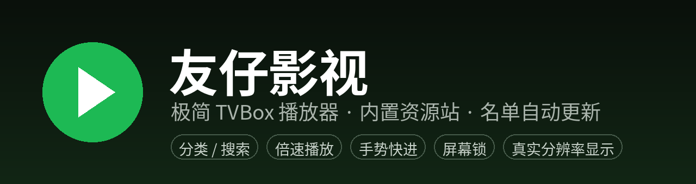

<p align="center">
  
</p>

<p align="center">
  
  
  
  
</p>

## 这是什么

友仔影视是一个**极简的空壳播放器**：

- **内置一份资源站名单**，装好打开就能用，不需要任何配置；
- **站点名单自动更新**：app 启动时会拉取本仓库的 `stations.json`，名单有新版就自动替换 — 站点失效不用等 app 发新版；
- 也可以**导入你自己的 TVBox 配置**（地址拉取 / 粘贴 / 本地文件），支持 type 0（XML）/ type 1（JSON）站点；依赖 jar 蜘蛛的 type 3 站点不支持，会在列表里标出来；
- 本软件**不生产、不存储、不分发任何影视内容**，播放内容来自你使用的数据源。详见 [免责声明](DISCLAIMER.md)。

## 功能

| 功能 | 说明 |
|---|---|
| 分类浏览 / 搜索 | 按站分类翻页、按片名搜索 |
| 线路 / 选集 | 多线路切换、选集播放 |
| 播放器 | ExoPlayer（media3）内核；小窗起播，一键全屏 |
| 画面比例 | 适应 / 铺满 / 拉伸 / 16:9 / 4:3，自动记住选择 |
| 倍速 | 0.5x – 2.0x |
| 手势 | 左右滑快进 / 后退（带目标时间提示），点按显隐控制条 |
| 屏幕锁 | 锁定后触摸不误触，点小锁解锁 |
| 分辨率显示 | 控制条上实时显示当前流的真实分辨率（如 1920×1080 · 1080P） |
| 续播 | 每集记忆播放位置；历史记录可单条删除 |

## 下载

通用版 APK 在仓库的 [`releases/youzai-video.apk`](releases/youzai-video.apk)（点开选 Download 即可）。

> 仓库里的 APK 使用通用图标（绿碟白三角）。作者自用版使用个人头像图标，功能完全相同。

## 构建

无 Gradle、无 Android Studio，一条脚本打包：

```bash
bash build.sh
```

需要：JDK 17、Android SDK（platform android-35、build-tools 34.0.0）。首次构建会通过 `fetch_deps.py` 拉取 media3 依赖（需要 curl 和网络）。签名钥匙在首次构建时在本机自动生成（`youzai.keystore`，已被 .gitignore 排除，**不要提交自己的钥匙**）。

## 站点名单

名单文件就是仓库根目录的 `stations.json`（同时也是 app 内置名单的来源）。想增删站点，改这个文件并把 `_bv` 数字加 1 推送，装了 app 的设备下次打开就会自动更新。

## 免责声明

本软件为通用播放工具，不提供任何影视内容；内容版权归原权利人所有，使用者应确保其使用符合所在地法律法规。完整声明见 [DISCLAIMER.md](DISCLAIMER.md)。

## 许可证

GPL-3.0
